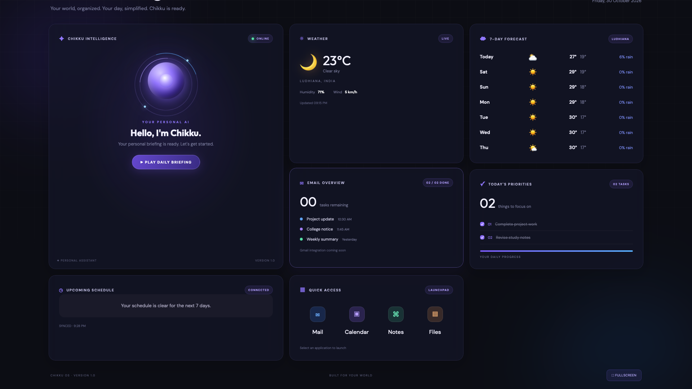

# CHIKKU OS — Personal Desktop Dashboard

A Python-powered personal desktop dashboard designed to bring everyday tools, information and productivity features together in one interface.

CHIKKU OS combines a modern dashboard UI with a Python backend, Google Calendar integration, live weather information, task management and macOS application launching.

## Dashboard Preview



## Features

- **Live Clock & Date:** Displays the current time and date.
- **Weather Dashboard:** Displays current weather and a 7-day forecast using Open-Meteo.
- **Google Calendar Integration:** Retrieves upcoming calendar events using the Google Calendar API.
- **OAuth 2.0 Authentication:** Uses Google's OAuth authorization flow for calendar access.
- **Automatic Synchronization:** Refreshes calendar information every five minutes.
- **Event Highlights:** Displays event dates, timings, calendar names and highlights today's events.
- **Task Management:** Allows tasks to be managed through the dashboard.
- **macOS Application Launcher:** Opens supported Mac applications directly from the dashboard.
- **Daily Briefing:** Uses browser text-to-speech functionality to provide a spoken briefing.
- **Dark Dashboard Interface:** A modern interface with a dark glass-style visual design.

## Technology Stack

| Technology | Purpose |
|---|---|
| Python | Backend development |
| HTML | Dashboard structure |
| CSS | Styling and layout |
| JavaScript | Frontend functionality |
| Google Calendar API | Calendar integration |
| OAuth 2.0 | Authorization |
| Open-Meteo API | Weather information |
| JSON | Calendar data and local configuration |
| macOS | Desktop application integration |

## Project Architecture

CHIKKU OS follows a simple client-server architecture.

1. The frontend is built using HTML, CSS and JavaScript.
2. The Python backend runs a local HTTP server.
3. The frontend requests calendar information from the backend.
4. The backend communicates with the Google Calendar API using authorized credentials.
5. The backend returns calendar information in JSON format.
6. JavaScript updates the dashboard with the retrieved information.

## Project Structure

```text
ChikkuOS/
│
├── index.html
├── style.css
├── script.js
├── server.py
├── setup_calendar.py
├── test_calendar.py
├── requirements.txt
├── .gitignore
├── README.md
│
└── screenshots/
    └── dashboard.png
```

## Installation & Setup

### 1. Clone the repository

```bash
git clone https://github.com/prince-h4x/Personalised-OS-Dashboard.git
cd Personalised-OS-Dashboard
```

### 2. Create a virtual environment

```bash
python3 -m venv .venv
source .venv/bin/activate
```

### 3. Install dependencies

```bash
pip install -r requirements.txt
```

### 4. Configure Google Calendar API

To enable calendar integration:

1. Create a project in Google Cloud Console.
2. Enable the Google Calendar API.
3. Configure OAuth consent and add your Google account as a test user if the app is in testing mode.
4. Create an OAuth client with the Desktop app application type.
5. Download the OAuth client JSON file.
6. Place it in the project directory and name it `credentials.json`.

### 5. Authorize Google Calendar

Run:

```bash
python setup_calendar.py
```

Complete the Google authorization process in your browser. This generates a local `token.json` file.

### 6. Start CHIKKU OS

```bash
python server.py
```

Open the following address in your browser:

```text
http://127.0.0.1:8000
```

## Security Considerations

- Google Calendar access uses OAuth 2.0 authorization.
- OAuth credentials and authorization tokens are stored locally.
- `credentials.json` and `token.json` must never be committed to a public repository.
- The virtual environment is excluded from version control.
- The local application launcher uses an allowlist of supported macOS applications.

**Important:** This project is designed for local use. Additional security hardening would be needed before exposing the server to a public network.

## What I Learned

Through CHIKKU OS, I explored:

- Building a frontend and Python backend together.
- Implementing client-server communication.
- Integrating third-party APIs.
- Understanding OAuth 2.0 authentication and authorization.
- Working with JSON-based API responses.
- Automating application launching on macOS.
- Managing Python dependencies and project environments.
- Using Git and GitHub for version control.

## Future Improvements

- Email integration with real account data.
- More interactive productivity widgets.
- Customizable dashboard layouts.
- Improved application security and configuration management.
- Additional desktop automation capabilities.

## Developer

**Prince Bhardwaj**

GitHub: https://github.com/prince-h4x

---

*CHIKKU OS — Bringing everyday productivity into one personal desktop dashboard.*
